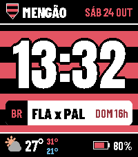
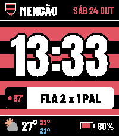
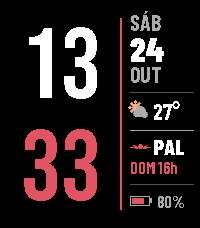
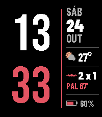
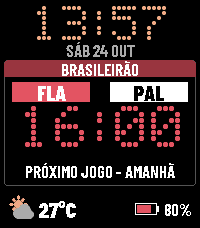
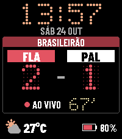
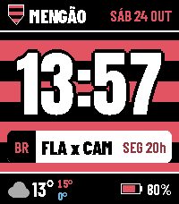

# Mengão

Mostrador rubro-negro para o **Pebble Time 2** (plataforma **emery**), feito com o Pebble SDK. Versão **1.3**.

Mostra a hora, a data em português, o clima, a bateria e o próximo jogo do Flamengo, com placar ao vivo quando a partida está em andamento.

## O que o mostrador faz

Há três visuais, escolhidos na página de configurações (ícone de engrenagem no app Pebble, feita com Clay):

- **Clássico listrado** — listras horizontais rubro-negras, escudo, hora grande e data.
- **Minimalista** — fundo preto, hora em destaque e as informações em coluna.
- **Placar / estádio** — visual de placar de LED, com o jogo em primeiro plano.

Em todos os estilos:

- **Hora** em 12 h ou 24 h, conforme o ajuste do relógio.
- **Data** abreviada em português (por exemplo, `SÁB 24 OUT`).
- **Clima** em **°C** ou **°F**, via Open-Meteo e a localização do celular. Dá para ocultar o clima e escolher o intervalo de atualização (15 min, 30 min, 1 h ou 2 h).
- **Próximo jogo do Flamengo** e **placar ao vivo** pela API pública da ESPN (Brasileirão, Libertadores, Copa do Brasil, Carioca e outras competições). Durante o jogo o placar é atualizado a cada minuto. O resultado final permanece na tela por cerca de 6 horas a partir do horário de início.
- **Vibração no gol** do Flamengo, ligada por padrão. Pode ser desligada nas configurações.
- **Bateria** em porcentagem, com o ícone ao lado. Também dá para vibrar quando o celular desconecta.

Clima e jogos dependem do celular pareado, com internet. O clima também pede permissão de localização para o app Pebble.

## Capturas

Emulador emery (200×228), Pebble Time 2.

### Clássico listrado

Próximo jogo:



Ao vivo:



### Minimalista

Próximo jogo:



Ao vivo:



### Placar / estádio

Próximo jogo:



Ao vivo:



### Build no emulador



A pasta `mockups/` guarda os estudos visuais usados no desenho do mostrador.

## Como instalar

O pacote pronto da versão 1.3 está em [`releases/Mengao-v1.3.pbw`](releases/Mengao-v1.3.pbw).

1. Baixe `Mengao-v1.3.pbw`.
2. No celular pareado com o relógio, abra o arquivo `.pbw` com o **app Pebble**.
3. Confirme a instalação. O mostrador **Mengão** entra na lista de watchfaces.

O estilo, a unidade de temperatura (°C/°F), o clima, os jogos e a vibração no gol ficam no ícone de engrenagem do app.

Versões anteriores, na mesma pasta:

- [`releases/Mengao-v1.2.pbw`](releases/Mengao-v1.2.pbw)
- [`releases/Mengao-v1.1.pbw`](releases/Mengao-v1.1.pbw)
- [`releases/Mengao-v1.0.pbw`](releases/Mengao-v1.0.pbw)

O que cada uma traz está no [CHANGELOG.md](CHANGELOG.md). O código da 1.2 fica no histórico do git. Os fontes da 1.0 e da 1.1 não foram guardados.

## Como compilar

É preciso o [Pebble SDK](https://developer.repebble.com) (`pebble` no `PATH`) e o Node.js. A página de configuração usa [Clay](https://github.com/pebble/clay) (`pebble-clay`).

```sh
npm install
pebble build
```

O `.pbw` gerado fica em `build/`. Para instalar no emulador do Time 2:

```sh
pebble install --emulator emery
```

O script `preview.sh` monta uma cópia temporária e tira uma captura com dados fictícios:

```sh
./preview.sh emery 0 2 /tmp/classico-aovivo.png
```

Argumentos: plataforma, estilo (`0` clássico, `1` minimalista, `2` placar), modo (`0` sem jogo, `1` próximo, `2` ao vivo, `3` placar final) e o caminho da imagem.

## Escudo

O escudo na tela é um desenho genérico: um contorno simples com listras rubro-negras. Ele não é o brasão oficial do Flamengo. O projeto não inclui logotipo, marca ou arte registrada do clube.

## Limitação conhecida

O alvo é o **emery** (Pebble Time 2, 200×228). As plataformas de **144×168** — **basalt** (Pebble Time) e **diorite** (Pebble 2) — estão em `targetPlatforms`, mas não foram testadas e podem travar o relógio.

## Layout

```
src/c/main.c          mostrador (C)
src/pkjs/index.js     clima (Open-Meteo) e jogos (ESPN)
src/pkjs/config.js    página de configuração (Clay)
resources/fonts/      fontes do relógio
mockups/              estudos visuais
screenshots/          capturas do emulador emery
releases/             pacotes .pbw (1.0 a 1.3)
wscript               regras de build do SDK
package.json          metadados, plataformas e recursos
```
