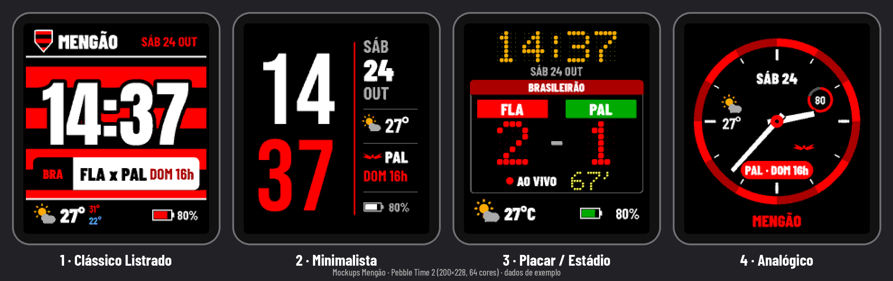

# Mengão para Pebble 🔴⚫ (v1.3.2)

Watchface de fã do Flamengo para **Pebble** (emery / basalt / diorite). Mostra o relógio, o clima e o próximo jogo (ou o placar ao vivo / final) puxado da ESPN.



## Funções
- Estilos: **Clássico**, **Minimalista** e **Placar**.
- Clima (Open-Meteo) e configuração pelo Clay no celular.
- Jogos do Flamengo via ESPN: próximo, ao vivo e final.
- Vibração de gol e de Bluetooth (opcional).
- Data do placar ESPN em `America/New_York` (com horário de verão).

## Instalar
Baixe o `Mengao-v1.3.2.pbw` da release e abra no app da Pebble / Rebble no celular.

## Compilar
Precisa do [Pebble SDK / Rebble](https://developer.repebble.com):

```sh
pebble build
pebble install --emulator emery
# ou: pebble install --phone <ip>
```

Plataformas em `package.json` → `pebble.targetPlatforms`: emery, basalt, diorite.

## Layout
```
src/c/           C do relógio
src/pkjs/        PebbleKit JS (clima, ESPN, Clay)
resources/       fontes
mockups/         prévias
screenshots/     capturas no emulador
test/            testes Node (data Eastern)
```

## Changelog
Veja `CHANGELOG.md`.

App de fã, sem vínculo oficial com o C.R. Flamengo. Autor: Barezin78.
